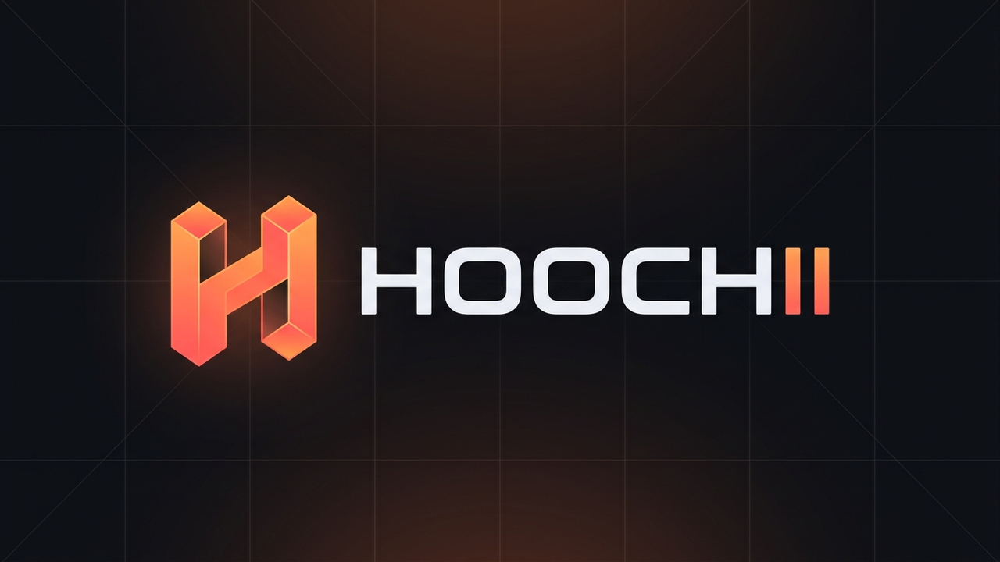

<!--
# SPDX-FileCopyrightText: Copyright 2026 Hoochii Emulator Project
# SPDX-FileCopyrightText: Copyright 2025 Eden Emulator Project
# SPDX-License-Identifier: GPL-3.0-or-later
# SPDX-License-Identifier: GPL-2.0-or-later
-->

  

<h1 align="center">Hoochii</h1>

  An open-source, high-performance Nintendo Switch &amp; Switch 2 emulator written in C++

  
  
  

---

**Hoochii** is an independent, open-source Nintendo Switch and Switch 2 emulator built in C++ with a custom Vulkan renderer, modern Qt 6 interface (**Hoochii Obsidian**), and continuous performance and correctness engineering. It builds upon the open-source lineage of Lichii, Eglantine, Eden, Sudachi, and yuzu while charting its own identity, polish, and optimization roadmap.

> [!NOTE]
> Hoochii is not affiliated with Nintendo. Use homebrew you have permission to run, or your own games and system files dumped from hardware you own, where permitted by applicable law. Games, keys, and firmware are not included.

## Downloads & Setup

Download official builds only from the [GitHub Releases](https://github.com/Hooopix/Hoochii/releases) page.

- **Windows**: Extract the archive and launch **`hoochii.exe`** (or **`hoochii-cli.exe`** from a terminal).
- **Linux**: Make the `.AppImage` executable (`chmod +x`) and run it, or extract the `.tar.gz` archive and run `hoochii` / `hoochii-cli`.
- **macOS (Apple Silicon)**: Open **`hoochii.app`** (if Gatekeeper blocks an unsigned build, right-click → Open or run `xattr -dr com.apple.quarantine hoochii.app`).

### Profile Data & Migration

Hoochii stores its profile in a dedicated directory:

- **Windows**: `%APPDATA%\hoochii`
- **Linux & macOS**: `$XDG_DATA_HOME/hoochii`, `$XDG_CONFIG_HOME/hoochii`, and `$XDG_CACHE_HOME/hoochii` (defaulting to `~/.local/share/hoochii`, `~/.config/hoochii`, and `~/.cache/hoochii`)
- **Portable mode**: A `user/` folder next to the executable takes priority and is left untouched.

On first launch, Hoochii automatically detects existing **Lichii**, **Eden**, and other legacy profiles and offers a safe one-click import wizard (Copy, Move, Link, or Start Fresh). `hoochii-cli` waits until you complete or skip initial setup in the GUI before writing a fresh configuration.

## Reporting Issues

When [opening an issue](https://github.com/Hooopix/Hoochii/issues), please include:

- The exact Hoochii build (from **Help → About Hoochii** or the top of `eden_log.txt`), game version, CPU, GPU, and driver version.
- Relevant settings and clear steps to reproduce.
- A screenshot and session log (checked for personal information).

Do **not** upload game files, keys, firmware, or private account data. Bug bundles, GPU traces, shader dumps, and crash dumps can contain game assets—do not post them publicly.

## Building & Contributing

See [docs/Build.md](docs/Build.md), [docs/user/README.md](docs/user/README.md), and [docs/Coding.md](docs/Coding.md).

- Desktop executables produced by CMake: `hoochii` (GUI), `hoochii-cli` (SDL CLI), `hoochii-room` (dedicated multiplayer room), and `hoochii-updater` (Windows update helper).
- Internal CMake target names (`lichii`, `lichii-cmd`, `lichii-updater`) and `LICHII_*` build options remain stable for compatibility with existing build scripts.

## Brand Identity & Theme

Hoochii ships with the **Hoochii Obsidian** visual theme—deep obsidian charcoal (`#0E1016`) paired with electric coral-amber (`#FF6B4A` → `#FFB347`) accents—along with bespoke platform icons and banners in [dist/branding](dist/branding) and [dist/qt_themes/hoochii](dist/qt_themes/hoochii).

## Credits and License

Hoochii stands on the shoulders of the Lichii, Eglantine, Eden, Sudachi, and yuzu open-source communities and their contributors, including Eglantine's original developer Camille LaVey. All upstream attributions and third-party license terms continue to apply.

Licensed under the **GNU General Public License v3.0 or later** (`GPL-3.0-or-later`). See [LICENSE.txt](LICENSE.txt) and individual source headers for details.
